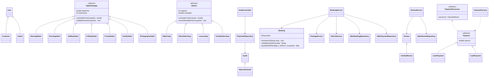

# Class relationships

Focused diagram of implemented OOP relationships. Services/controllers/repositories not shown exhaustively.

The diagram can be rendered by Mermaid-capable Markdown viewers. SQL and file ownership are explained in [the technical overview](TECHNICAL_OVERVIEW.md).
